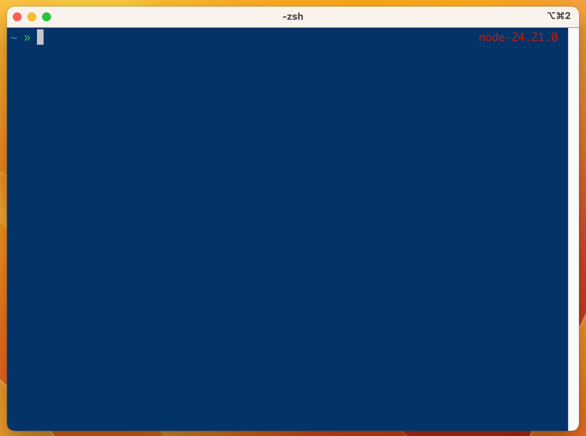

# YADR 2027

[](https://github.com/marcoarata/dotfiles/actions/workflows/ci.yml)

Yet Another Development Runtime — the classic YADR experience for Zsh, Tmux and
Neovim, rebuilt on a modern stack without complex configuration.

<p align="center">
  
</p>

## Overview

YADR 2027 keeps the classic YADR experience contract — Zsh + Vim everywhere + mnemonic aliases + tmux + fluid Git + Damoekri prompt — and replaces the aged implementation (RVM + Rake + Vundle + fasd + ag + hub) with a modern stack with no mandatory Ruby.

Philosophy:

- **Experience > plugins.** Capabilities and muscle memory are preserved, not plugin lists.
- **Vim Everywhere.** Zsh vi-mode, Neovim/Vim, tmux hjkl.
- **Fallbacks, never hard failures.** Every modern alias (`eza`, `bat`, `rg`, `fd`, `zoxide`, `delta`) degrades to the POSIX tool when missing; `delta` is wired as the git pager only when it is installed.
- **Core vs extras.** Portable core for macOS/Linux/WSL/SSH. macOS hacks and iTerm go to extras.
- **Customization without forking.** `before / after` hooks around the defaults.
- **Damoekri is sacred.** The prompt is modernized internally, its personality stays unchanged.

> ⚠️ **Nerd Font required.** The Damoekri prompt and tmux glyphs render broken
> without one. Install a [Nerd Font](https://www.nerdfonts.com) and select it in
> your terminal emulator before checking the prompt. Without it, everything
> still works (degrades to plain glyphs).

## Installation — YADR 2027

### 1) macOS

#### Option A — Automatic (recommended)

**1. Homebrew (only if missing)**

```bash
/bin/bash -c "$(curl -fsSL https://raw.githubusercontent.com/Homebrew/install/HEAD/install.sh)"
```

**2. Minimal dependencies**

```bash
brew install curl git zsh
```

**3. Install YADR 2027 (downloads bootstrap, detects macOS/arm64,
   installs prerequisites via platform/macos.sh, clones into ~/.yadr-2027
   and runs bin/yadr install with automatic backup)**

```bash
bash -c "$(curl -fsSL https://raw.githubusercontent.com/marcoarata/dotfiles/main/bootstrap.sh)"
```

**4. Enter your environment**

```bash
zsh
```

**5. Verify (1st run slow once: installs nvim plugins; 2nd run instant)**

```bash
yadr doctor
```

> macOS Intel (Tier 3 since Homebrew 7.0.0, Sep 2026): Homebrew no longer
> builds bottles for Intel and its installer is Apple Silicon only.
> YADR detects Intel and installs via MacPorts first (`PORT_PACKAGES`,
> `delta`→`git-delta`), with XDG clones for zsh plugins as no-sudo
> fallback. Install MacPorts from https://www.macports.org first, then run
> the same bootstrap. Field report: `docs/homebrew-intel.md`.

#### Option B — Manual and auditable (no `curl | sh`)

Use this path if you prefer to audit the source locally before running it.
It is an alternative to Option A, not a step after it.

```bash
git clone https://github.com/marcoarata/dotfiles.git ~/.yadr-2027
```

```bash
~/.yadr-2027/bootstrap.sh
```

```bash
zsh
```

```bash
yadr doctor
```

### 2) Linux — Debian/Ubuntu, server, WSL

#### Option A — Automatic (recommended)

**1. System base**

```bash
sudo apt update && sudo apt upgrade -y
```

**2. Minimal dependencies**

```bash
sudo apt install zsh curl git -y
```

**3. Install YADR 2027 (detects linux/wsl, installs via
   platform/linux.sh or platform/wsl.sh, clones into ~/.yadr-2027
   and runs bin/yadr install with automatic backup)**

```bash
bash -c "$(curl -fsSL https://raw.githubusercontent.com/marcoarata/dotfiles/main/bootstrap.sh)"
```

**4. Enter your environment**

```bash
zsh
```

**5. Verify (1st run slow once: installs nvim plugins; 2nd run instant)**

```bash
yadr doctor
```

#### Option B — Manual and auditable (no `curl | sh`)

Same alternative to Option A on Linux, WSL and servers:

```bash
git clone https://github.com/marcoarata/dotfiles.git ~/.yadr-2027
```

```bash
~/.yadr-2027/bootstrap.sh
```

```bash
zsh
```

```bash
yadr doctor
```

### 3) Pin a release (optional, recommended for servers)

`bootstrap.sh` follows `main` by default. To install one exact release:

```bash
curl -fsSL https://raw.githubusercontent.com/marcoarata/dotfiles/main/bootstrap.sh | bash -s -- --ref v0.3.0
```

or, from an existing checkout:

```bash
~/.yadr-2027/bootstrap.sh --ref v0.3.0
```

The tag is checked out detached (not a branch tip) and its `VERSION` file must
match the tag: a mislabelled tag stops the bootstrap instead of installing
something you cannot identify later. `--local --ref vX.Y.Z` applies the same
verification to a checkout you copied by hand. Releases and their pins:
`docs/releases.md`.

### 4) Post-install (explicit order, same steps the CLI prints)

**1. Enter a fresh shell (or reboot, then open a terminal)**

```bash
exec zsh
```

**2. First check (slow ONCE: downloads nvim plugins, toolchains, fonts)**

```bash
yadr doctor
```

**3. Check again (instant now; shows the real state)**

```bash
yadr doctor
```

**4. Install whatever is still missing, until 0 errors / 0 warnings**

```bash
yadr install node
```

```bash
yadr install python
```

```bash
yadr install lazygit
```

```bash
yadr install tools   # eza/bat/delta for the full modern shell (see below)
```

```bash
yadr install typescript
```

```bash
yadr theme list
```

### What is NO LONGER done (differences from classic YADR)

- No `gnupg2` install for RVM.
- No RVM or Ruby 3.1.0 install (`rvm install/use` removed).
- No `gem install rake` (Rake is no longer the engine).
- No legacy `install.sh` from `skwp/dotfiles`.
- No manual Damoekri setup (`promptinit / prompt damoekri`):
  `shell/zshrc` already sources `shell/damoekri.zsh`, with Git +
  `yadr_runtime_context` (outside a project: global node; inside: only the
  runtimes the project pins).
- `yadr diff` shows what would change before touching anything;
  `yadr backup` saves to `~/.local/state/yadr/backups/<timestamp>/`.

### Verification

```bash
exec zsh
yadr doctor   # 1st run slow once (installs nvim plugins); 2nd run instant
yadr diff     # read-only, changes nothing
```

Post-install order (no guessing): `doctor` twice, then only the profiles
you need — `yadr install node|python|typescript|ruby|rust|lazygit|tools`,
`yadr theme [list|use light|dark|none]`. Full flow: `INSTALL-YADR.md`.

Equivalence details: `docs/migration.md`.
One-page quick install: `INSTALL-YADR.md`.

## `yadr` commands

**Environment and profiles**

- `yadr install [profile]` — symlinks, backup and dependencies.
  Profiles: `core|node|typescript|ruby|python|rust|lazygit|tools|development|macos-extras`
  (no profile = `core`).
- `yadr update` — `git pull` + `mise upgrade` (with backup and confirmation).
  When the pull fails it keeps your checkout as it was, says so and exits
  non-zero (it never prints a success line for an update that did not happen).
- `yadr uninstall [--dry-run] [--purge]` — removes symlinks, restores your
  backup and reverts the login shell.
- `yadr runtime current|list|use|doctor` — runtime abstraction (mise underneath).

**Diagnostics and safety**

- `yadr doctor` — checks the environment with repair hints.
- `yadr diff` — shows what would change, without modifying anything.
- `yadr backup` — copies to `~/.local/state/yadr/backups/<timestamp>/`.
- `yadr benchmark shell|nvim|cd|prompt` — measures startup and cd/prompt cost.

**Customization and extensions**

- `yadr pack list|add <name>` — optional packs (javascript/typescript/ruby/python/rust).
- `yadr theme [list|use <name>|current]` — Solarized background (light|dark|none, default none).
- `yadr gitsigns [on|off|status]` — Git signs in Neovim (default: off).
- `yadr migrate [--dry-run]` — imports `.vimrc.before/.after`, `.vundles.local`… (idempotent).
- `yadr export [--out FILE]` — bundles the state git cannot carry for you:
  `~/.gitconfig.user`, the theme, mise `conf.d` pins and migrated classic files.
- `yadr apply FILE [--dry-run]` — restores such a bundle on another machine.
  It verifies every file against the bundle's SHA-256 manifest (and refuses
  unknown members) *before* writing anything, and backs up what it overwrites.
- `yadr version` — prints the version.

> **Global toolchains.** Your custom tool pins live in
> `~/.config/mise/conf.d/*.toml`; mise merges them over the base. Do not edit
> the managed `runtime/mise.toml` (symlinked as `~/.config/mise/config.toml`):
> editing it dirties the checkout and can make `yadr update` refuse to
> fast-forward. `yadr install tools` writes `~/.config/mise/conf.d/yadr-tools.toml`
> for you when it installs `eza`/`bat`/`delta` on Linux/WSL (on macOS they come
> from Homebrew/MacPorts).

## Classic YADR → 2027

| Classic | 2027 | Note |
|---|---|---|
| RVM + Ruby + Rake | `bootstrap.sh` + `yadr` (bash/zsh) + optional mise | Ruby is no longer an install dependency |
| `rake install` | `yadr install` | idempotent, with prior backup and `yadr diff` as dry-run |
| `rake update` | `yadr update` | same contract |
| Vundle + 90 plugins | lazy.nvim, curated subset + LSP + Treesitter | see `docs/mappings.md` |
| fasd / `z` | zoxide, `z` command preserved | fallback to `cd` |
| ag | ripgrep (`rg`), `,gg/,gd/` mappings preserved | |
| `ls/cat/find/grep/diff` | eza/bat/fd/rg/delta with fallback | `delta` wired as git pager only when present; originals always available via `command` |
| hub / ghi | `gh` | |
| Exuberant ctags | Universal ctags and/or LSP | `,f` preserved |
| Powerline fonts | Nerd Fonts | verify Damoekri/tmux glyphs |
| Prezto | YADR Zsh Core (audited subset) | no mandatory heavy framework |
| Vim | Vim + Neovim (shared Editor Layer) | shared mappings |
| tmux + Solarized + iTerm | tmux + Solarized/Damoekri + terminal abstraction | iTerm to `platform/macos/` |
| `~/.vimrc.before/.after` | `custom/before/`, `custom/after/` hooks around the defaults | never need to fork; coexistence via parallel mode + backup (migrate on roadmap) |
| `~/.gitconfig.user` | `~/.gitconfig.user` (unchanged) | included from the managed `git/gitconfig`, so your identity never lands in the repo |

Full details: `docs/mappings.md`, `docs/migration.md`.

## Repo layout

```text
.
├── bootstrap.sh        # portable entrypoint
├── bin/yadr + bin/lib/ # CLI dispatcher + modules (install/recover/doctor/runtime/benchmark; see docs/cli-contract.md)
├── shell/             # zshrc, aliases, functions, completion, damoekri prompt
├── git/               # base gitconfig + YADR aliases
├── nvim/ / vim/      # shared Editor Layer
├── tmux/              # Vim-key tmux.conf
├── runtime/           # Runtime Layer: mise.toml, node/python/ruby/rust
├── packs/             # optional packs (typescript, python, ruby, rust, javascript)
├── platform/          # macos/ linux/ wsl/ tools/ common/
├── custom/            # optional before/ after/ hooks (user-owned; never touched by update)
├── docs/              # architecture + ADRs, cli-contract, mappings, migration,
│                       troubleshooting, releases, e2e-report, evaluation
└── tests/             # smoke.sh, shell.bats, fault.bats, coverage.sh, fixtures/
```

## Packs

Packs = optional on-demand installable layers:

```bash
yadr pack list
yadr pack add typescript
yadr pack add ruby
```

Each pack ships a `mise.toml` fragment, aliases, and editor config. Core never
depends on a pack. `yadr pack list` prints the packs this checkout ships
(`javascript`, `typescript`, `python`, `ruby`, `rust`). See `docs/architecture.md`.

## Damoekri

Damoekri is a first-class component, not a swappable theme. Preserved:

- directory + editor mode on the left
- git branch + status on the right
- Solarized look by default

The right side is runtime-aware: outside a project it shows the global node; inside a project it shows **only the runtimes the project itself pins** (a per-project `mise.toml`/`.tool-versions`, or a local version file), never the inherited globals. A project with no pins falls back to the global node. Implemented in `shell/damoekri.zsh`, which consumes `yadr_runtime_context` from `shell/runtime.zsh` and never invokes managers directly. Without a Nerd Font it renders degraded (no broken glyphs).

More: `docs/architecture.md`, `docs/troubleshooting.md`.
